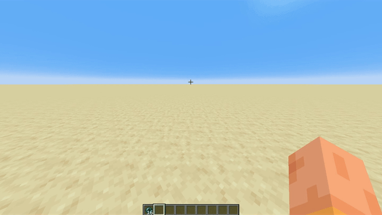

# Click Pearl

<p align="center">
  <a href="https://minecraft.net"></a>
  <a href="https://fabricmc.net"></a>
  <a href="https://fabricmc.net"></a>
  <a href="https://modrinth.com/user/KrejziBro"></a>
  <a href="LICENSE"></a>
</p>

Высокопроизводительный клиентский Fabric-мод для Minecraft 1.21.4, позволяющий мгновенно бросать жемчуг Края (Ender Pearl) по нажатию выделенной клавиши без необходимости вручную переключать активный слот инвентаря или выпускать из рук оружие и инструменты.

Выполняет переключение и бросок строго в течение одного игрового тика, полностью исключая визуальные глитчи и отправляя корректные валидные сетевые пакеты, неотличимые от стандартных действий игрока.

<p align="center">
  
</p>

## Основные возможности

* **Мгновенный бросок перла**: Бросает эндер-перл прямо из любой ячейки хотбара нажатием одной кнопки, мгновенно возвращая в руку исходный предмет.
* **Отсутствие визуальных глитчей**: Смена выбранного слота и обратный возврат рассчитываются за один клиентский тик — никакой анимации мелькания в руках.
* **100% совместимость с античитами**: Отправляет строго стандартизированную последовательность сетевых пакетов (`ServerboundSetCarriedItemPacket` ➔ `ServerboundUseItemPacket`), что гарантирует отсутствие ложных детектов на популярных античит-системах (GrimAC, Vulcan, Polar, Matrix).
* **Гибкая настройка кейбинда**: Клавиша броска легко настраивается в стандартном меню управления игрой (по умолчанию назначена на СКМ / Middle Mouse Button).
* **Автоматическое разрешение конфликтов**: Умно перехватывает и подавляет ванильные действия на той же кнопке (например, ванильный выбор блока Pick Block).
* **Поддержка второй руки (Offhand)**: Корректно определяет и использует жемчуг Края, если он находится в левой руке.

## Быстрый старт

### 1. Системные требования
* Minecraft версии `1.21.4`
* [Fabric Loader](https://fabricmc.net/use/installer/)
* [Fabric API](https://modrinth.com/mod/fabric-api)

### 2. Загрузка готового мода
Готовый скомпилированный `.jar` файл доступен на официальной странице автора на [Modrinth](https://modrinth.com/user/KrejziBro). Поместите скачанный файл в папку `.minecraft/mods/`.

### 3. Сборка из исходников

```bash
# Клонирование репозитория
git clone https://github.com/KreziBro/click-pearl.git
cd click-pearl

# Сборка проекта через Gradle
./gradlew build
```

Скомпилированный мод появится в каталоге `build/libs/`. Скопируйте файл в директорию `mods` вашего игрового клиента.

## Стек технологий

* **Загрузчик**: [Fabric Loader](https://fabricmc.net/)
* **Библиотеки**: [Fabric API](https://modrinth.com/mod/fabric-api)
* **Язык и среда**: Java 21, Gradle

## Сообщество и поддержка

* Официальный Telegram канал разработчика: https://t.me/KreziBro_dev
* Поддержать развитие проекта на платформе Ko-fi: https://ko-fi.com/krejzibro

## Лицензия

Распространяется под свободной лицензией CC0-1.0 Universal (Public Domain).
